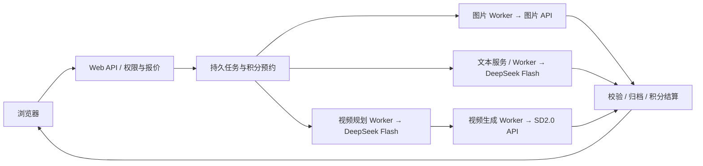

# Image Workbench — 图片生成与修改工作台

基于 FastAPI 的图片、脚本、分镜与视频创作工作台。用户在网页中管理项目、提交生成任务、查看结果并继续修改；应用负责账号与 Workspace 隔离、持久队列、积分结算、文件校验和版本归档。

当前主要链路通过 **图片 API、DeepSeek Flash API 和 SD2.0（Seedance 2.0）视频 API** 完成生成。网站与执行器可以部署在服务器上，无需以本机 Codex CLI、ChatGPT 登录或 ComfyUI/GPU 作为这套 API 流程的运行前提。

代码仓库：[mhaiyan203-hue/image-workbench](https://github.com/mhaiyan203-hue/image-workbench)。现有公网入口：[https://124.156.182.151](https://124.156.182.151)。配置和执行细节见 [当前 API 调用与部署流程](docs/api_runtime.md)；运行状态以带日期的 [部署核验记录](docs/tencent_live_deployment.md) 为准。

## 当前能力与接口

| 功能 | 当前调用方式 | 应用负责的部分 |
| --- | --- | --- |
| 图片生成、参考图生成、历史图片编辑 | `ImageAPIBackend`，配置模型默认 `gpt-image-2`；调用 `/v1/images/generations` 或 `/v1/images/edits` | 参考图快照、任务去重、候选图校验、归档与版本关联 |
| 脚本、剧本和分镜规划 | `DeepSeekTextAdapter` 调用 DeepSeek Flash；目录与价格来自 `config/deepseek/` | 模板与 Skill、源版本、文本回执、分镜审核和后续任务关联 |
| AI 强化提示词 | `DeepSeekFlashClient`，由 `config/prompt_enhancement.json` 与路由配置控制 | 原文保留、强化结果编辑与回填；点击“使用强化版”只更新输入文字 |
| 视频提示词整理 | `OnlineVideoPlanner` + `seedance-2-video` Skill + DeepSeek Flash | 独立规划阶段、检查点、输出结构验证 |
| 视频生成 | `OnlineVideoWorker` 调用 SD2.0 HTTP API，保存供应商任务号并轮询结果 | 防止未知结果重复提交、下载校验、交付尺寸处理、MP4 归档和积分结算 |

SD2.0 当前接入范围是 **720p T2V 文生视频，5／10／15 秒，16:9／9:16／1:1**。图片编辑支持参考图，不代表当前视频接口已经支持首帧、首尾帧或多参考图生视频。积分以服务端配置及提交前报价为准。

H3、ComfyUI 和 Codex CLI 的实现及历史记录仍保留，用于兼容旧任务、显式选择的旧后端和排查历史执行；它们不是当前网站新任务的主流程。底层 CLI 的兼容默认值尚未全部改为 API，因此运行图片 API 时应明确指定 `--backend image-api`。

## 创作与执行流程

视频工作台 `/video` 按 **图片 → 脚本 → 分镜审核 → 视频** 四步组织，图片主页为 `/`，独立脚本页面为 `/scripts`。

1. 创建主项目、子项目，上传参考图或生成图片；历史结果可选作新图片编辑的基底。
2. 生成或上传脚本，保留 TXT 版本；规划分镜后逐镜审核。
3. 对已审核镜头点击“生成此镜头视频”，核对模式、有效参考图数量、时长、交付尺寸与冻结积分后提交。
4. Worker 从持久队列领取任务，调用对应 API；完成后保存、校验并归档结果，网页读取同一任务的状态。



保存草稿不触发生成。重复提交沿用原请求 ID 与队列幂等规则；刷新网页不会重新调用模型。站内积分由现有账本冻结和结算，明确失败释放冻结，结果未知时先核对原执行。未领取的视频排队任务可取消；已领取或结果未知的任务按恢复指引处理。图片 API 的有限重试与视频供应商任务号恢复有不同规则，见 [API 流程](docs/api_runtime.md)。

## 本地启动

在当前仓库根目录运行，开发数据使用独立目录：

```powershell
python -m venv .venv
.\.venv\Scripts\python.exe -m pip install -r requirements-web.txt
```

把 [图片 API 配置示例](deploy/image-api.example.json) 复制为 `deploy/image-api.local.json`，填入实际供应方地址、Key 和模型。创建 `deploy/text-api.local.json`，内容为 `{"api_key": "填写自己的 DeepSeek API Key"}`。这些 `deploy/*.local.json` 文件已被 Git 忽略。

```powershell
$env:IMAGE_WORKBENCH_IMAGE_API_CONFIG = (Resolve-Path 'deploy/image-api.local.json').Path
$env:IMAGE_WORKBENCH_TEXT_API_CONFIG = (Resolve-Path 'deploy/text-api.local.json').Path
.\.venv\Scripts\python.exe -X utf8 -m image_workbench --data-root work/dev-data web --backend image-api --port 7860
```

打开 **http://127.0.0.1:7860**。此命令启动本地网页和图片队列执行；脚本、分镜及 AI 强化使用已配置的文本 API。完整在线视频生成需使用提供 Worker 接口的 `cloud` 入口，并启动视频规划与生成 Worker，见 [API 配置与进程说明](docs/api_runtime.md)。

并行工作区的端口和数据目录以 `work/worktree-info.json` 为准，网页启动入口为 `work/start-web.ps1`；详见 [并行开发说明](docs/parallel_development.md)。

仅验证图片保存、执行、审核和下载流程时，可使用固定图片演练后端：

```powershell
.\.venv\Scripts\python.exe -m image_workbench --data-root work/mock-data web --backend local --image tests/manual_batch_cases/assets/fragrance.webp --port 7861
```

`local` 只替换图片后端；文字与视频功能仍使用各自配置，不能把整个网页视为全功能离线模式。

## 服务器部署

服务器以 `cloud --backend image-api` 接收任务，图片 API Worker、文本 Worker、视频规划 Worker、视频生成 Worker 分别消费对应队列。`remote-worker` 表示通过 HTTP 领取和回传任务，执行器可以与网站部署在同一服务器，也可以部署在独立执行主机。

运行配置与供应方密钥放在服务器私密文件或进程环境中。`IMAGE_WORKBENCH_WORKER_TOKEN` 用于本站与执行器之间的认证，供应方 API Key 用于调用模型，两者用途不同。

完成服务器初始化和本机 SSH 配置后，用现有发布入口检查、打包、上传、切换版本并做健康检查：

```powershell
.\scripts\deploy.ps1 -PackageOnly
.\scripts\deploy.ps1
```

服务布局、各类 Worker 和恢复方法见 [API 流程](docs/api_runtime.md)、[远程图片执行](docs/remote_deployment.md) 与 [一键部署](docs/one_click_deploy.md)。

## 开发与验证

Python 3.12 是当前验证环境。安装开发依赖与 Chromium，前端组件检查需要 Node.js，视频媒体检查需要 FFmpeg／ffprobe：

```powershell
.\.venv\Scripts\python.exe -m pip install -r requirements-dev.txt
.\.venv\Scripts\python.exe -m playwright install chromium
.\.venv\Scripts\python.exe -X utf8 scripts\verify.py
# 单功能检查，同时运行公共契约、请求边界和前端组件检查
.\.venv\Scripts\python.exe -X utf8 scripts\verify.py --module video
```

统一检查先运行 Ruff 和架构防护，再运行测试。自动化验证使用独立临时数据及 Mock／本地后端；真实供应方调用另行验收。Windows 下宜使用已存在的短路径临时目录，避免深层测试产物触及路径长度限制。

## 代码与数据

| 位置 | 职责 |
| --- | --- |
| `image_workbench/composition.py` | 全站服务装配与依赖注入 |
| `image_workbench/http_api/`、各 `*_web.py` | HTTP 适配、身份与请求边界 |
| `image_workbench/image_api_backend.py` | 图片 API Provider |
| `image_workbench/deepseek_text.py`、`deepseek_flash.py` | 文本生成与轻量提示词强化适配 |
| `image_workbench/online_video_planner.py`、`online_video_worker.py` | 视频提示词规划及供应商提交、轮询、回传 |
| `image_workbench/storage.py`、`managed_files.py`、`accounts.py` | 产物登记、受管文件、账号与积分事务 |
| `config/`、`skills/` | 模型与价格配置、创作规则及模板 |
| `image_workbench/web_templates/`、`image_workbench/web_static/` | 页面与原生 JavaScript 组件 |
| `scripts/`、`deploy/` | 检查、发布脚本及无密钥配置示例 |

任务、Artifact 与版本元数据使用 JSON，账号、Workspace、项目归属和积分账本使用 SQLite。正式图片由 `StorageManager.register_output_*` 登记，业务层先核验 Workspace；供应方适配器不自行扣款或改写归档。

业务数据包含 `.identity/`、`.workbench/`、`.video/` 与 `projects/` 等目录。备份应使用 [备份恢复流程](docs/backup_restore.md)，不能只复制图片。通过 Web／应用服务使用锁和幂等机制；直接调用底层存储并不自动获得网页权限或跨文件事务保证。

## 文档入口

- [当前 API 调用与部署流程](docs/api_runtime.md)
- [网页使用手册](docs/web_guide.md)
- [图片 API 接入与协议细节](docs/image_api_integration.md)
- [AI 强化提示词](docs/prompt_enhancement.md)
- [模块结构与依赖方向](docs/architecture.md)
- [HTTP 契约](docs/web_api_contract.md)、[存储契约](docs/storage_contract.md)、[执行契约](docs/execution_contract.md)
- [内测反馈优化与验收](docs/beta-feedback-audit-20261110.md)
- [历史 H3 流程](docs/h3_pipeline.md)、[历史脚本生成验收](docs/video_script_generation.md)、[底层存储示例](example.py)

历史文档记录当时的模型、测试与部署状态，当前调用入口以本文和 `composition.py` 为准，实时服务状态须通过部署探针核实。
